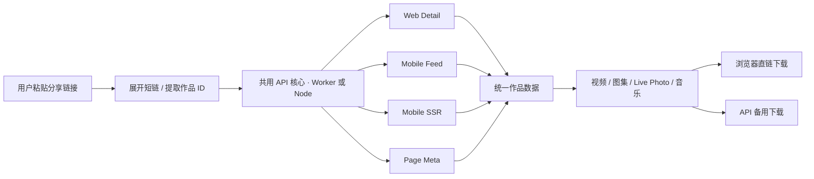
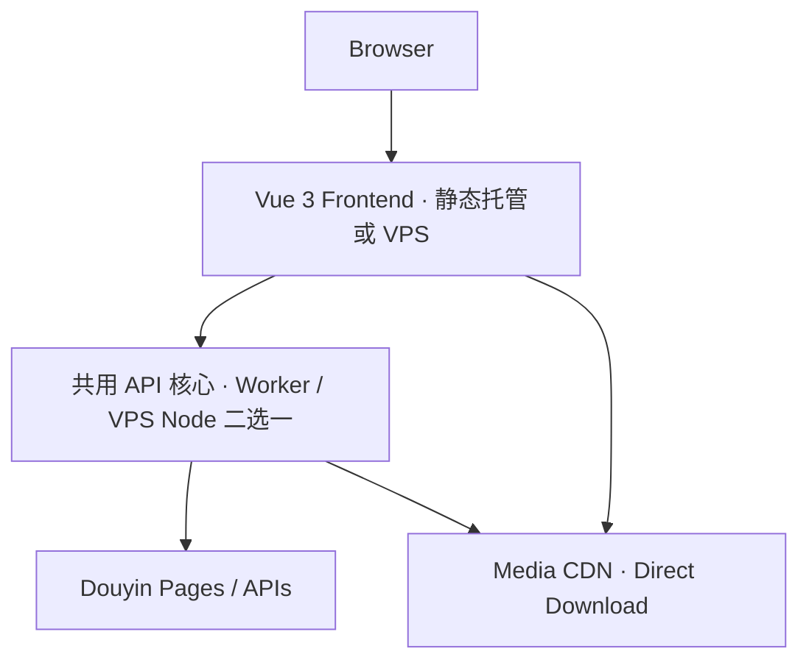

# 实现与开发说明

[返回 README](../README.md) · [部署指南](deployment.md) · [API 说明](api.md) · [实现与开发说明](implementation.md)

解析、下载和诊断的实现约定。首次运行项目请先阅读 [README](../README.md#本地运行)。

## 解析流程



解析器不会盲目使用返回列表中的第一条作品，而是严格校验目标作品 ID，避免误解析到推荐视频。

对于图文作品，会按图片标识或相同资源地址合并不同接口、不同列表中的资源，不按数组下标配对：

- 合并重复图片，保留已发现的 Live Photo 动态轨。
- 同一图片优先保留明确来自可信无水印字段的地址。
- 采用更完整图片列表的顺序，同时保留其他已识别资源。
- 只有动态轨、缺少静态图片或已知资源不完整时，继续尝试备用解析策略。

主策略优先执行，慢请求等待 600 ms 后可启动备用策略；某次尝试失败时，尚未运行的策略优先获得机会，再继续原策略的重试。最多同时进行两个上游尝试，配额覆盖等待响应、读体和资源提取，排队不占单次请求超时。解析达到总时间预算或策略耗尽时，有可用图文资源则返回已有结果，因此无法保证上游缺失的资源一定能补齐。背景音乐在上游提供时随作品返回。

Mobile Feed 在所有策略已启动、没有更高优先级请求排队且有空闲配额时，可提前尝试相邻的一个备用节点。结果仍按原节点顺序裁决，并保留已返回的更好图片及实况资源；成功路径最多额外启动一个相邻请求，全部失败时仍只尝试原来的四个节点。

跨策略合并会保留已有作者、封面和音乐，并补充缺失字段；音乐地址与标题配对处理，避免将不同音乐混在一起。图片及已声明的实况资源是否已获取，与是否确认无水印分别判定：已获取全部已识别资源、但无水印状态未确认时，页面提示“图片已获取，无水印状态未确认”；资源完整性未确认时才显示补齐警告，可下载已有资源或点击重新解析。备用策略仍会继续寻找更好的图片资源。

核心解析逻辑位于：

```text
backend/src/parsers/douyin.ts
```

## 下载策略

“优先直连”指浏览器优先请求解析结果中的抖音媒体 CDN 地址。作品解析仍通过 `/api/parse`，它与媒体文件的下载路径是两件事。前端托管在 Vercel、Pages 或 VPS，以及后端使用 Worker 或 Node，都保留这套策略。

`VITE_API_BASE_URL` 决定解析和 `/api/download` 代理请求的目标，不会替换媒体直链。自动回退使用当前配置的同一个 API；Worker 和 Node 之间没有自动切换。直连成功时文件不经过本项目 API，代理下载才消耗 API 的媒体转发流量。

### 视频

默认优先直接从媒体 CDN 下载：

```text
浏览器 → 抖音媒体 CDN
```

浏览器直接接收文件并显示下载进度，媒体不经本项目的 API 转发；实际速度取决于用户到媒体 CDN 的网络。

当视频直连获取出现 CORS、超时或超过页面缓冲阈值等情况，且任务未被取消时，会自动切换到：

```text
浏览器 → API（Worker 或 Node）→ 抖音媒体 CDN
```

API 通过 `Content-Disposition` 提供建议文件名，实际保存名称和操作取决于浏览器。切换备用下载后，请到浏览器下载列表查看进度。

文件已经接收、仅发起浏览器保存失败时，使用“再次保存”复用已接收的文件，不触发代理重新下载；取消或已被新任务替代的下载也不触发回退。

单项代理下载通过独立下载框架发起，保持主页面打开。API 在媒体响应开始前返回的失效、限流等错误会回传到页面，并附上请求编号；资源失效时提供重新解析入口。普通 API 调用仍返回 JSON 错误，成功的媒体仍流式传输，不新增预检请求或整文件缓存。浏览器自身拦截、应用之外的网络/边缘错误及传输开始后的失败，仍需查看下载列表；页面的“已发起下载”不代表保存成功。

前端直链下载当前限制：

```text
视频最大缓冲：128 MiB（普通视频、单个实况 MP4）
等待响应：8 秒
读取停滞：15 秒
总时长：持续收到数据时不限制
```

**128 MiB 是普通视频自动下载时的浏览器缓冲阈值，不是视频最大下载容量。** 解析结果提供所选视频流的有效文件大小时，已知超过阈值的视频直接交给 API 流式代理下载，避免先接收一部分再重下；不额外发起 HEAD 或探测请求。大小缺失时仍尝试直连，实际接收过程中继续执行上限保护。代理不设置此文件大小上限，但仍受网络、上游和运行环境约束。

单个实况 MP4 与普通视频共用直连优先的下载流程，显示接收进度并支持取消、30 秒内再次保存。直连失败或超过 128 MiB 浏览器缓冲阈值时，回退到 API 流式下载；多项实况仍按现有 ZIP 分包流程处理。

同时保留 **打开直链** 和 **备用下载**，方便不同浏览器 / 网络环境下手动选择。

视频、单张图片、音乐、封面和当前 ZIP 接收完成后，在当前页面暂留文件 30 秒；自动保存被浏览器拦截时，可点击“再次保存”复用同一 Blob 与对象地址，不重新 GET 或打包。首次发起保存失败时也可重试保存。再次保存由按钮点击同步触发；页面只能确认已交给浏览器，不能确认文件已落盘。该暂存只服务当前下载任务，不缓存作品解析结果。

页面同一时间只允许一个缓冲任务，开始另一任务先释放上一任务的保存暂存；重新解析、清空、取消、离开页面和到期时也释放引用。按源文件与输出文件预约的页面预算为 256 MiB：普通视频与单个实况 MP4 的单文件接收上限为 128 MiB，图片、封面和音乐仍为 64 MiB，ZIP 每包媒体内容仍为 32 MiB。浏览器复制、解码、下载管理器及垃圾回收行为不在此计数中，因此这不是物理内存硬上限。

### 单张图片、封面与音乐

背景音乐、封面和单张图片优先从媒体 CDN 直连读取，等待响应最多 8 秒、读取停滞最多 15 秒；仅在 `NETWORK`、`TIMEOUT`、`EXPIRED`、`INVALID_MEDIA` 错误时回退一次 API 代理。切换时清空前一次下载进度，取消、服务繁忙或文件过大等其他错误直接结束任务。与视频交给浏览器原生下载不同，这些单文件的代理响应仍在页面缓冲，受 64 MiB 上限约束。代理回退均在客户端设置 30 秒响应等待、45 秒读取停滞保护，给 API 的上游超时留出传输余量。持续收到数据时不限制总下载时长，保留进度、取消和再次保存。

### 图文 / Live Photo

批量任务逐项优先直连媒体 CDN，获取失败时对当前项回退一次 `/api/download`；取消或 `TOO_LARGE` 不触发代理回退。ZIP 在浏览器生成，后端只在回退时转发对应媒体，不负责打包。

图文支持：

- 下载单张图片
- 下载全部图片
- 优先下载 Live Photo 动态轨
- 单独下载静态原图
- 显示逐项状态，失败后只重试未完成项
- 取消、重新解析或离开页面时释放缓存

“下载全部”采用动态优先模式：每项有实况视频时下载 MP4，否则下载静态图片。“下载全部原图”只收集可用静态图片。例如，包含 3 个实况资源的作品，动态优先包通常含 3 个 MP4，原图包含 3 张图片；不会在同一个操作中自动把两者都收集进去。Live Photo 下载为独立静态图或 MP4，不会自动生成手机相册中的实况照片。

批量图片在响应头提供有效大小、当前图片不超过本包剩余容量的一半时，最多同时获取两张，并按原顺序打包。两张图片共用本包剩余字节预算；未知大小的当前图片和实况视频保持串行，不另发探测请求。当前项失败时取消预取，已按顺序完成的文件仍保留供重试；超出剩余容量的文件留到下一包重新获取。

批量下载使用 ZIP 保存，每包媒体内容最多 **32 MiB**（ZIP 元数据会有少量额外开销），所有设备采用同一较小分包，减少手机同时持有源文件和 ZIP 的压力。小作品完成后自动请求保存；超过单包容量时，页面提供“保存第 N 包”和“继续准备下一包”，由用户逐包点击，避免浏览器拦截连续下载。单个文件超过 32 MiB 时请使用单项下载入口。

打包以 256 KiB 分块读取 Blob，不再创建整包 Uint8Array。页面每次只准备一个包，失败时保留本包已获取文件；包保存后释放源文件，短暂保留当前 ZIP 供再次保存，准备下一包时释放上一包的保存引用。失败暂存或尚未保存的包 30 秒到期后需重新准备；已保存包的进度仍可继续。最终 ZIP 和浏览器保存过程仍占用内存，不等于零内存下载。上游不提供文件长度时，跨包边界的未完成文件可能需要在下一包重新获取。

批量媒体直链获取保留响应及读取超时，不设持续传输的总时长限制。ZIP 代理回退在客户端设置 30 秒响应等待、45 秒读取停滞保护，覆盖浏览器到 API 的连接，同时给 API 的上游超时留出传输余量；失败后保留本包已完成文件，可只重试未完成项。API 对上游等待响应头最多 15 秒（重定向共用），每次读取停滞最多 30 秒；支持取消传递，保留 Range 流式下载。上游返回 HTTP 416 时保留范围错误及相关长度信息，供浏览器处理续传边界。传输开始后的异常会终止响应流，无法再改成 JSON 错误响应。

代理根据响应 `Content-Type` 拒绝明确的 HTML、JSON 等非媒体内容，避免将错误页面保存成视频。缺少类型或声明为 `application/octet-stream` 的响应仍可透传；该检查不等于对文件内容做完整识别。下载请求使用 `Accept-Encoding: identity`；上游仍返回压缩媒体时拒绝并返回 502，不通过改写 `Content-Range` 掩盖字节不一致。

### 如何核对实际下载链路

打开浏览器开发者工具的 Network 面板，选择 All 并清空已有请求，然后逐项观察：

1. 解析作品时，请求应发往配置的 API 的 `/api/parse`；同域部署时由 Nginx 将这个请求转发给 Node。
2. 普通视频或单个实况 MP4（不超过 128 MiB）、单张图片（不超过 64 MiB）下载时，先请求抖音媒体 CDN。直连成功后通过页面生成的 Blob 保存，该次下载不应再请求 `/api/download`。
3. 直连失败触发回退，或手动点击“备用下载”时，应出现当前 API 的 `/api/download` 请求。视频的原生下载通过隐藏 iframe 发起，仅查看 Fetch/XHR 可能漏掉它。
4. 已知超过 128 MiB 的普通视频应直接请求 `/api/download`。预览封面本身也可能请求 CDN，应按下载点击后的请求时间和媒体类型区分。

这些步骤用于核对路径；文件是否保存成功仍需检查浏览器下载列表。代码入口：[视频与单个实况](../frontend/src/composables/useMediaDownloads.ts)、[图片/封面/音乐](../frontend/src/composables/useFileDownload.ts)、[ZIP 获取与打包](../frontend/src/utils/batch-download.ts)、[代理地址与原生下载](../frontend/src/utils/download.ts)、[页面缓冲阈值](../frontend/src/utils/download-buffer.ts)。

## 图片与无水印策略

抖音不同接口返回的图片字段并不完全一致，因此项目不会简单把所有 `url_list` 都标记为“无水印”。

当前优先级大致为：

```text
watermark_free_download_url_list
        ↓
origin_image
        ↓
display_image
        ↓
普通 url_list
        ↓
download_url / download_addr
```

只有明确来自高可信无水印字段的资源，前端才会显示：

```text
下载无水印原图
```

其他资源会显示：

```text
下载高清原图
```

避免把普通 CDN 地址错误标记成无水印。

单张图片、封面及 ZIP 中的图片，会根据已识别的响应 MIME 修正为 JPG、PNG、WebP 等后缀，不进行图片转码。缺少 MIME、通用二进制类型或未识别的图片类型会保留原建议文件名，不能仅凭后缀判断实际格式。

## 技术架构



### 前端

- Vue 3
- Vite
- TypeScript
- 原生 CSS

图文支持大图、缩略图、总览与放大查看。视频仅显示封面，实况仅显示静态图片，不加载播放器；页面聚焦内容确认与下载。图文可切换动态优先与仅保存原图，下载继续使用原有的进度、取消、再次保存和 ZIP 分包流程。

页面布局位于 `frontend/src/App.vue`，静态图文预览位于 `frontend/src/components/ImageGallery.vue`，下载反馈统一使用 `frontend/src/components/DownloadTask.vue`，文件明细默认收起。

### 后端

- `backend/`：共用 TypeScript / Fetch API 业务核心
- `worker/`：Cloudflare Workers 入口及原生 Rate Limiting
- `server/`：独立 Node HTTP 入口、单进程内存限流与并发保护

两种入口二选一，不是主备或自动故障切换；前端界面及 API 协议共用。Node 部署不依赖 Cloudflare 账号、数据库或 Redis。

### 工程

- npm workspaces
- Vitest 回归测试
- Wrangler（仅 Worker 开发/部署入口使用）

## 开发与质量检查

提交或部署前，在仓库根目录执行：

```bash
npm ci
npm run check
```

需要单独检查时可运行 `npm test`、`npm run lint`、`npm run check:frontend` 或 `npm run build`；完整验证以 `npm run check` 为准。

`check` 依次执行 Prettier 格式检查、ESLint、Vitest 回归测试、Vue 模板/脚本类型检查、前端构建、共用核心与 Worker 类型检查及 Node 构建。提交前可运行 `npm run format` 修正格式。仓库通过 `.gitattributes` 和 `.editorconfig` 统一使用 LF，避免 Windows/WSL 换行差异。

前端使用 `vue-tsc`，开发期 TypeScript 固定在 5.9 系列以匹配其编译器接口；不再使用临时生成组件脚本的检查方式。回归测试直接使用 Vitest 模块替身和 Vue effect scope，不再手工加载或编译组件。

- `frontend/src/composables/useVideoPage.ts`：解析请求及取消状态。
- `frontend/src/composables/useMediaDownloads.ts`：视频、图片及批量下载生命周期。
- `frontend/src/composables/useNotice.ts`：通知及定时器清理。
- `backend/src/parsers/douyin.ts`：请求策略与兜底顺序。
- `backend/src/parsers/douyin/`：页面提取、作品匹配、媒体选择和结果映射。
- `shared/media.ts`：前后端共用图片 MIME 与下载后缀处理。
- `shared/video.ts`：前后端共用 API 类型，图文完整性通过可选 `imagesComplete` 与无水印确认分别表达。

GitHub Actions 会在 main 推送和 Pull Request 时，分别在 Windows 与 Linux 上使用 Node 22、24，从锁文件安装依赖并执行 `npm run check`。另一个 Linux 作业安装 Nginx 和 OpenSSL，执行 `npm run check:nginx` 验证部署链路。配置不会自动发布前后端。

开发依赖中的 Miniflare 暂时通过根目录 `overrides` 固定 `undici@7.29.1`；锁定版本不代表没有安全公告，部署前需结合实际 `npm audit` 结果复核，依赖升级后重新运行回归检查。

## 版本与验收

前端构建后可访问 `/version.json` 查看提交号和构建时间；后端 `/api/health` 返回 `runtime`（`cloudflare-worker` 或 `node`）及版本 ID、完整提交 tag 和时间。API 响应包含 `X-Request-ID`、`X-API-Version`、`X-API-Runtime`，并保留兼容头 `X-Worker-Version`；Node 返回兼容头不表示经过了 Worker。解析失败提示会附带可用的请求编号，便于关联脱敏日志。

Node 的版本在 build 时生成并存入 `server/dist/version.json`，重启不变、重建生成新 ID；缺失或非法元数据会拒绝启动。产物 `index.mjs` 与该元数据必须配对，独立运行不需要 `node_modules`。

响应还通过 `Server-Timing` 提供在响应头发送前已完成的固定 `worker`、`resolve`、`primary` 耗时（毫秒），不包含作品信息或媒体地址。普通 JSON 的 `worker` 包含内部各阶段，不能与另外两项再次相加；渐进解析及下载的 `worker` 仅表示响应准备耗时。渐进解析的最终等待通过 `parse_stream_complete` 和 `parse_selection` 日志测量，不能用响应头到达时间替代。开发模式前端分别输出响应头到达与最终结果耗时。

每次现有上游请求记录一条 `upstream_attempt`，分开测量响应等待、读体和提取耗时，并记录固定接口类别、尝试次数、HTTP 状态和结果类别。`parse_first_usable` 与 `parse_selection` 分别记录首次可用内容和最终选优时间，以及图片、动态轨、无水印确认数量和作者、封面、音乐是否存在。日志字段与类别经过白名单过滤，不包含分享文案、作品标题、媒体地址或原始异常；诊断不额外调用上游接口。

下载响应成功不代表手机已经保存，真实保存行为需单独验收。

发布工具采用当前完整 Git SHA 给 Worker 标记版本；实际发布要求工作区已提交。`npm run release:worker` 只预览命令，`npm run release:worker -- --dry-run` 仅在本地打包，`npm run deploy:worker` 使用既有 Wrangler 登录或环境凭据发布。根目录与 Worker workspace 的部署入口都使用同一版本检查。

合并、通过 `npm run check` 后，从固定提交发布配对前后端。使用 Worker 的组合先发布 Worker，再发布前端；全 VPS 同域部署按版本目录同步切换；独立前端与 VPS API 则协调两端发布/回滚。部署位置与后端运行时可以分别选择，见 [部署指南](deployment.md) 和 [VPS 教程](../VPS_DEPLOY.md)。

👉 **[检查线上部署版本](../RELEASE_CHECK.md)**：包含对照主干最新提交的可复制命令、结果解读，以及前后端分别发布时的检查方式。

文件大小 `videoSize` 是可选字段：新前端兼容未提供大小的旧 API；要启用已知大视频提前交给浏览器的优化，需要同时更新 API。

复制 `scripts/acceptance-samples.example.json` 到本地目录或已忽略的 `docs/`，填写不同普通视频、图文和实况的真实分享文案、预期数量、作品 ID，以及需保留的元信息与无水印数量下限。真实清单无需提交。发布后执行：

```bash
npm run release:acceptance -- --worker https://api.example.com --samples 'docs/acceptance-samples.json'
```

替换示例 API 地址和清单路径。`release:acceptance` 当前保留参数名 `--worker`，其值也可为 Node API 基址；不要改成该脚本尚未支持的 `--api`。验收顺序解析三类样本，核对版本、元信息、图片及动态轨数量，并通过下载代理读取代表媒体的 1 KiB 前缀后取消响应；上游忽略 Range 时会报告实际接收的数据块大小，不下载整文件。响应有字节限制及请求/整体期限，遇到限流停止后续样本。`--dry-run` 只检查清单且不联网，`--parse-only` 只执行接口解析。这些检查不代表画面观感、实际整文件保存或手机真机验收。

部署位置变更应使用同版本、独立限流 namespace、无生产路由的隔离 Worker 对照，再决定是否采用；只凭本机耗时不修改生产位置。真机验收应分别在 iPhone Safari、Android 浏览器及应用内浏览器确认普通视频、图片/ZIP、音乐/封面的保存、再次保存、取消及分包操作。

## 页面加载与错误反馈

前端配置跨域 HTTPS API 时，页面打开即添加一个 `preconnect` 提示，利用用户粘贴文案前的时间提前建立连接，不提前调用解析接口。浏览器可选择忽略提示，实际收益取决于网络和浏览器；同源 API 不添加该提示。

首页 HTML 自带加载提示与手动刷新入口，不依赖应用脚本或样式先下载完成。等待 8 秒后只提示资源仍在加载；实际加载或启动失败时才提示失败，不自动刷新或重新发起解析。

解析失败后可点击“重试解析”，使用当前输入重新请求；不会自动重复请求。也可主动点击“复制问题信息”，复制固定错误类别、阶段、耗时及可用的 HTTP 状态、请求编号和版本信息。该报告不含分享文案、作品信息、媒体地址或原始异常；只保留当前失败，重新解析、清空、取消或离开页面时丢弃，不自动上报。
